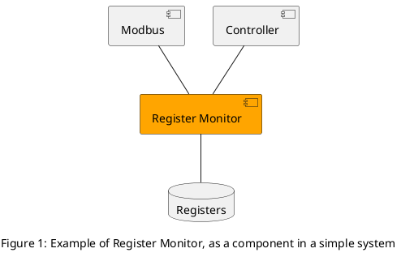
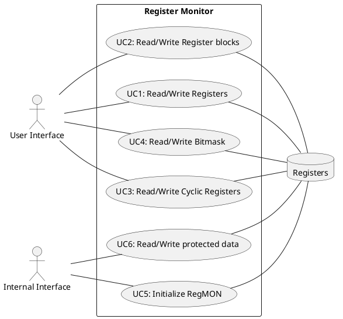

# Register Monitor

Author: Anders Bjoerk

## Revision

| Version | Date       | Changes               |
|:-------:|:----------:|:---------------------:|
| 0.1     | 2026/10/18 | Initial documentation |

[TOC]

## Module Context

In this chapter you can find the different context where a Register Monitor might be used.

### What is a Register Monitor

A Register Monitor is in its simple form, the access point for other components to access, mainly read and write, device registers.  

In embedded programming, and smaller devices, it is common to have a list of registers or parameters that can are globally accessed.  
By having a module monitoring the access to these, code can be made more safe and stable. Especially in devices that utilizes RTOS, where multiple task can access registers at once!

Register can be anything that the device need to operate, and should be made for each independent device.

## Module description

### Actors

***User Interface***: User Interface represent any external access to the device. Eg. Serial connection.

***Internal Interface***: Internal interface represent task or threads with special condition. Note that Internal Interface as access to the same use cases as User Interface.

### Database

This part is the registers described for the device.

### Use cases

***UC1: Read/Write Registers***  
This use case allows the different component to read or write single registers via the Register Monitor.

***UC2: Read/Write Register Blocs***
This use case allows the different component to access blocks of registers at once.  
A block is defined a coherent number of registers.
